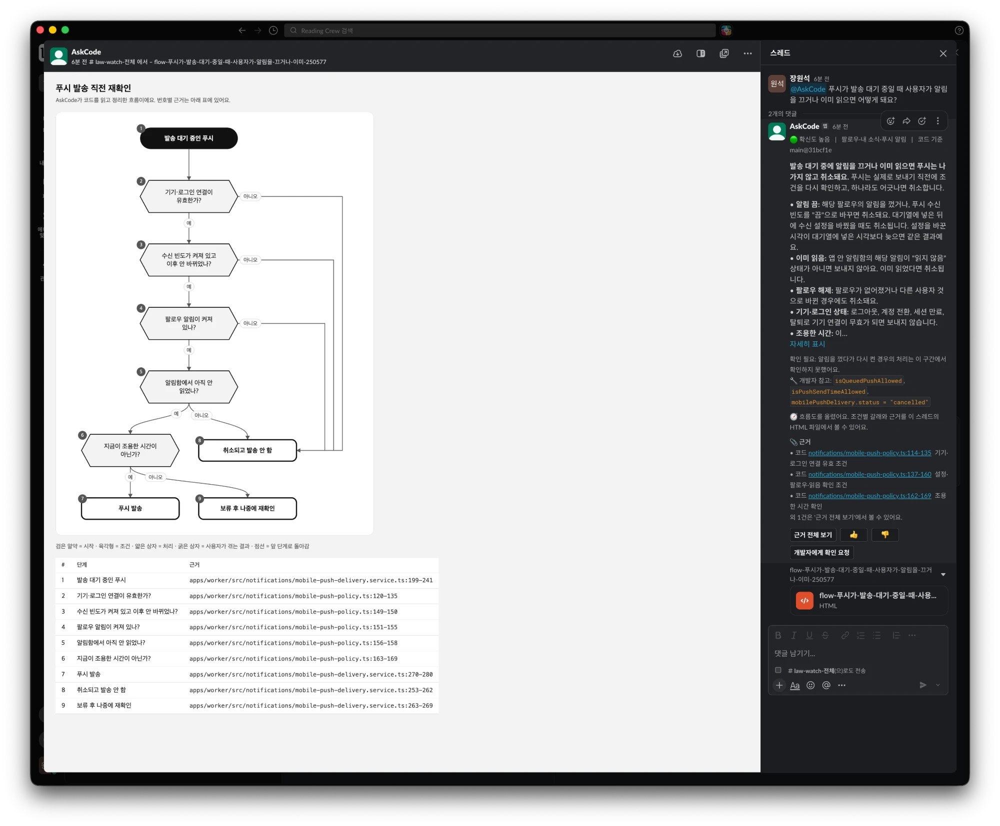
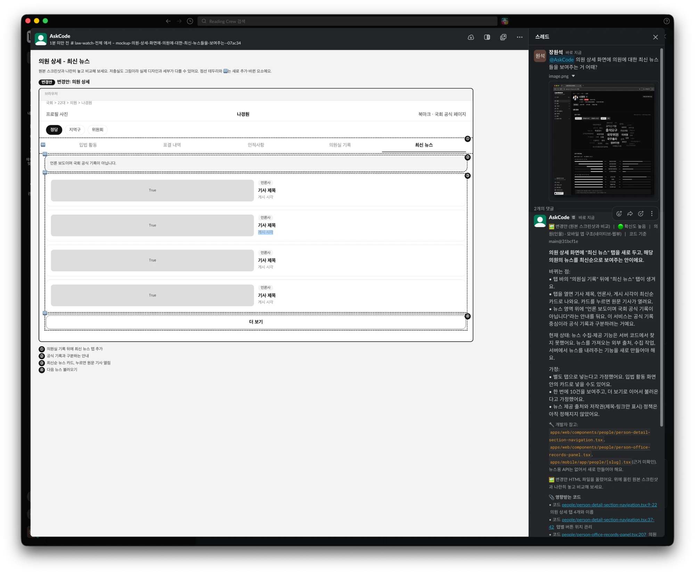
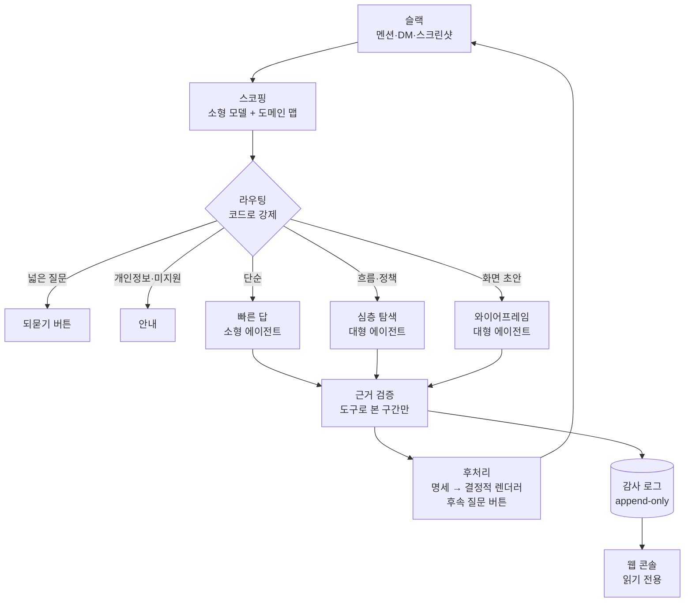
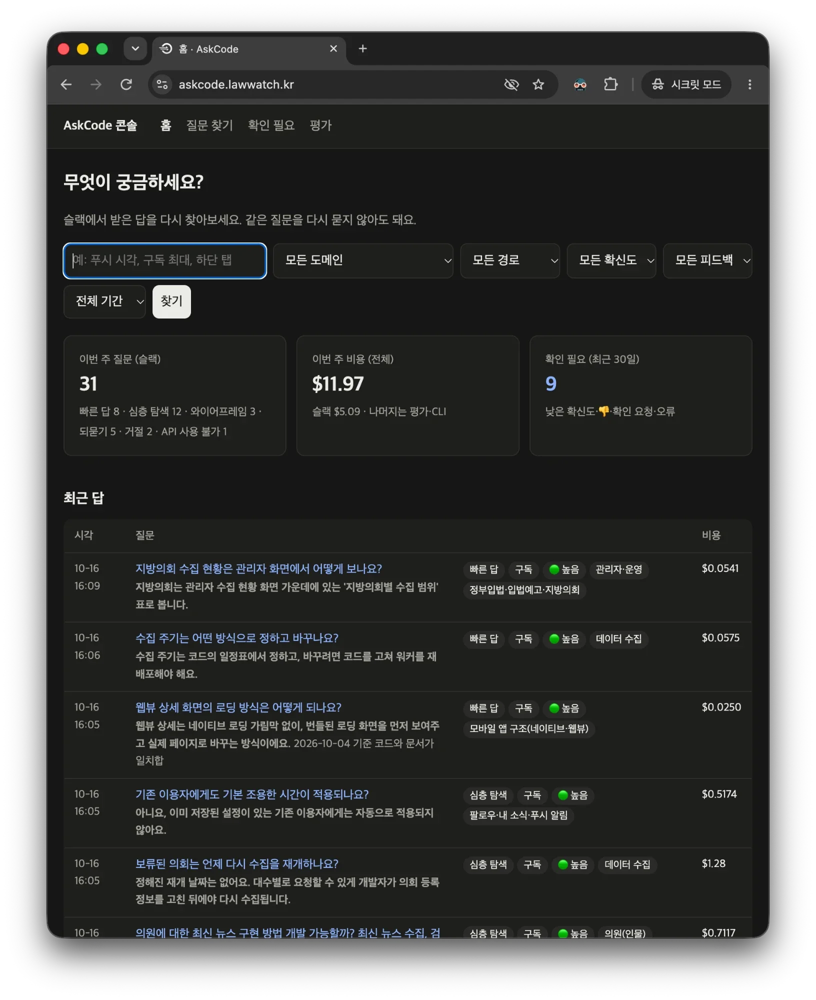
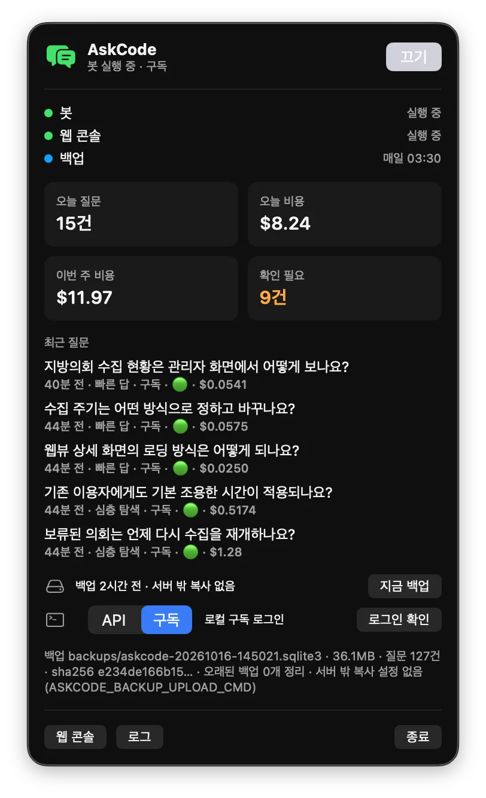

# AskCode

**기획자가 슬랙에서 묻고, 코드가 근거로 답하는 사내 Q&A 봇**

| | |
| --- | --- |
| 기간 | 2026년 10월, 2일 (커밋 82개) |
| 역할 | 1인 기획·설계·구현·평가·운영 |
| 대상 코드베이스 | 개인 프로젝트 LawWatch: Next.js 웹, Expo 하이브리드 앱(네이티브 + 웹뷰), NestJS API·워커 모노레포, 인덱싱 대상 약 3,200개 파일 |
| 기술 | Python 3.12 · Claude Agent SDK · Anthropic API(Sonnet 5.5·Haiku 5.5) · Slack Bolt(Socket Mode) · SQLite(FTS5) · Starlette · SwiftUI(macOS 메뉴 막대) · launchd · Docker |
| 규모 | Python 약 6,800줄, 테스트 138개, Swift 약 500줄, 설계·운영 문서 10편 |

## 한눈에 보기

| 문제 | 해결 | 결과 |
| --- | --- | --- |
| 기획자가 "이 화면은 웹뷰야?", "푸시는 몇 시에 가?"를 개발자에게 반복해서 묻는다 | 슬랙에서 물으면 에이전트가 코드와 기획 문서를 읽고, **모든 근거를 `파일:줄`로 붙여** 답한다 | 골든 세트 정답률 **50% → 86%** (28문항) |
| AI 답을 그대로 믿기 어렵다 | 근거가 봇이 도구로 **실제로 읽은 구간인지 코드로 검증**하고, 결과로 확신도를 정한다 | 검증 못 한 인용은 답에서 빠지고 확신도가 내려간다 |
| 질문마다 비싼 모델을 돌리면 비용이 커진다 | 소형 모델이 먼저 범위를 정하고, **라우팅을 코드로 강제**한다 | 되묻기 **$0.0003**, 빠른 답 **$0.003**, 심층 탐색 **$0.046**(중앙값) |
| 슬랙 답은 흘러가고 같은 질문이 반복된다 | 감사 로그를 쌓아 **웹 콘솔**에서 다시 찾고, 근거 코드가 바뀌었으면 알려 준다 | 질문·답·근거·비용이 한곳에 남는다 |

# 1. 문제

하이브리드 앱은 같은 화면이 웹뷰일 때와 네이티브일 때 동작이 다르고, 버튼 하나가 웹 → 앱 브리지 → 서버를 거친다. 기획자는 이 흐름을 코드에서 찾을 수 없어 개발자에게 묻는다. 개발자는 매번 코드를 다시 열어 답하고, 그 답은 슬랙 스레드에 묻힌다. 기획서는 코드와 어긋나도 아무도 모른다.

목표는 세 가지였다.

1. 기획자의 질문에 **근거와 함께** 답해서 개발자가 답을 검증만 하면 되게 한다.
2. 답이 틀릴 수 있다는 사실을 **숨기지 않는다**. 확인한 것과 못 한 것을 구분해 보여 준다.
3. 실제로 쓸 수 있는 **비용과 응답 시간**을 측정으로 보인다.

# 2. 제품

## 질문 유형별 동작

| 질문 | 동작 | 실측 |
| --- | --- | --- |
| "앱 하단 탭에는 어떤 메뉴들이 있어요?" | 소형 모델의 빠른 답 | 약 10초 · $0.003 |
| "웹뷰 상세에서 팔로우 버튼을 누르면 어떻게 저장돼요?" | 대형 모델이 웹 → 앱 → API를 따라가며 레이어별 근거 | 15~30초 · 약 $0.05 |
| "알림 로직 알려줘" | 범위가 넓으면 탐색하지 않고 도메인 버튼으로 되묻기 | 2초 · $0.0003 |
| "매일 받기 푸시는 몇 시예요? 기획서랑 같아요?" | 노션 기획서와 코드를 함께 인용하고 ⚠️ 불일치 지적 | 약 17초 · $0.07 |
| "푸시 대기 중에 알림을 끄면 어떻게 돼요?" | 조건이 2개 이상이면 근거가 달린 **로직 흐름도** 첨부 | 추가 약 $0.005 |
| "커뮤니티 기능 추가 시 와이어프레임 만들어줘" | 기존 화면 관례를 따른 저충실도 **와이어프레임** | 16~17초 · $0.04 |
| (화면 캡처) "여기에 최신 뉴스 탭을 넣으면?" | 화면 문구로 코드를 찾고, **변경안 목업**과 영향받는 코드 위치 | 16초 · $0.064 |
| "이 버그 고쳐서 PR 올려줘" | 하지 않는 작업이라고 안내 (개인정보 요청과 다른 문구) | $0.0003 |

답 아래에는 근거 전체 보기, 👍·👎, 개발자에게 확인 요청, 그리고 답의 맥락에서 이어서 물을 만한 **후속 질문 버튼 2~3개**가 붙는다.

## 화면

*정책 질문에 대한 답(오른쪽)과 흐름도(왼쪽). 흐름도의 각 노드에 근거 코드 구간이 표로 붙는다.*

*"커뮤니티 기능 추가 시 와이어프레임"에 대한 답. 앱 3화면에 번호 주석과 "가정" 목록이 붙는다.*

*실제 화면 캡처에 "최신 뉴스 탭" 추가를 요청한 결과. 새로 생기는 요소만 점선과 🆕로 표시하고, 개발자에게 넘길 영향 코드 위치를 붙인다.*

# 3. 아키텍처

- **에이전트 도구는 읽기 전용 9개뿐**이다. 화면 방식 찾기(`find_screen`), API 연결 찾기(`find_api`), 웹뷰 ↔ 앱 메시지 찾기(`find_bridge`), 코드 검색·읽기, 폴더 보기, 문서 검색·읽기, 범위 넓히기(질문당 1회). Agent SDK의 내장 도구(Bash, 파일 편집)는 끄고, 허용 목록 밖 도구는 훅에서 막는다.
- **동기화(10분 주기)**: GitHub App으로 얕은 클론 → 코드 인덱스, 구조 맵(API 109건, 라우트 91개, 화면 manifest 42개, 브리지 메시지), 문서 인덱스, 커밋별 파일 해시. 노션 기획서와 지정 슬랙 채널도 수집한다.

# 4. 핵심 설계 결정

## 근거는 모델의 말이 아니라 코드로 검증한다

에이전트가 답 끝에 적은 `파일:줄`을 하나씩 확인한다. 인덱스에 있는 파일인지, 줄 범위가 맞는지, 그리고 **이번 질문에서 도구로 실제 읽은 구간인지**를 본다. 통과한 인용만 답에 남기고, 하나라도 빠지면 확신도를 낮춘다. 폴더 구성을 세는 질문처럼 줄 번호가 없는 근거는 `list_dir`로 본 폴더만 인정한다.

> 결과: 슬랙 답의 근거 링크는 모두 실제 코드로 열리고, 검증하지 못한 인용 개수는 답 아래에 표시된다.

## 라우팅은 프롬프트가 아니라 코드가 정한다

소형 모델은 질문의 유형과 도메인만 JSON으로 판단하고, 어느 경로로 갈지는 코드가 정한다. 범위가 넓은 질문은 탐색 없이 도메인 버튼으로 되묻는다. 13개 도메인마다 허용 경로가 있어 에이전트는 그 안에서만 검색하고, 범위를 넓히려면 이유를 대고 한 번만 넓힐 수 있다.

> 결과: "알림 로직 알려줘"는 $0.07·20초짜리 탐색이 아니라 $0.002짜리 되묻기로 끝난다.

## 모델은 그림을 그리지 않고 명세만 낸다

와이어프레임과 흐름도는 처음에 모델이 HTML을 직접 썼다. 출력 토큰이 비용의 60%였고, 모델 출력을 그대로 열게 하는 보안 부담도 있었다. 모델은 짧은 **화면·흐름 명세(JSON)**만 내고, **결정적 렌더러**가 HTML·SVG를 그리도록 바꿨다. 모델 값은 이스케이프된 텍스트로만 들어가고, 외부 접근을 막는 CSP를 넣는다.

> 결과: 와이어프레임 1건 **$0.10·40초 → $0.04·17초**. 매번 같은 모양이 나오고, 스크립트가 끼어들 경로가 사라졌다.

## 기획서 비교는 "기획서를 보고, 코드로 확인한다"

같은 주제의 레포 문서가 검색 상위를 차지해 노션 기획서가 밀려나는 문제가 있었다. 문서 검색에서 노션·슬랙 결과에 자리를 보장하고, "현재 동작은 반드시 코드로 확인한다"를 규칙으로 넣었다.

> 결과: 기획서·코드 불일치 3문항 **1/3 → 3/3**. "코드는 09:00, 기획서는 오전 8시"처럼 양쪽을 인용해 지적한다.

## 감사 로그는 지우지 않는다

질문·답·근거·탐색 과정·비용을 SQLite에 남기고, 트리거로 수정·삭제를 막는다. 개인정보가 섞이면 행은 남기고 텍스트만 가리며(`redact`), 가린 기록도 지울 수 없다. 스키마는 `user_version` 기반 마이그레이션으로 관리한다.

# 5. 측정과 개선

## 골든 세트와 평가 하네스

law-watch 코드를 직접 읽어 정답과 근거 파일을 적은 28문항(단순·정책·화면·멀티홉·설계 결정·되묻기·거절·기획서 불일치)을 만들고, 답을 대형 모델이 판정하게 했다. 실패는 **스코핑·검색·생성** 중 어느 단계 문제인지로 나눠 고쳤다.

| 회차 | 정답률 | 비용 | 주요 변경 |
| --- | --- | --- | --- |
| 1차 | 50% (14/28) | $0.67 | — |
| 2차 | **86% (24/28)** | $0.83 | 아래 개선 |
| 노션 3문항 | 1/3 → **3/3** | $0.29 | 문서 검색 순위, 기획서 비교 규칙 |

## 측정으로 찾은 문제들

| 증상 | 원인 | 조치 |
| --- | --- | --- |
| 넓은 질문이 되묻기 대신 $0.07짜리 탐색으로 감 | 소형 모델의 기본 thinking이 400토큰 한도를 다 써서 JSON이 잘림 | 분류 호출은 thinking을 끄고 한도 상향 |
| 단순 경로 3문항이 답 없이 끝남 | 소형 모델이 턴 한도에 걸림 | 실패하면 대형 에이전트로 한 번 승격 |
| 판정 이유는 "맞음"인데 결론은 "틀림" | 소형 판정기가 잘리고 모순됨 | 잘린 판정은 무효 처리, 판정기를 대형 모델로 |
| 스코핑 지표가 항상 실패 | 골든 세트 8문항이 존재하지 않는 도메인 id를 씀 | id 교정 + 도메인 맵과 대조하는 테스트 |
| 표시 비용이 실제와 다름 | SDK 보고 비용이 토큰 × 공식 단가보다 작고, 소형 모델 단가 설정이 10배 과대 | 비용을 토큰 × 단가로 직접 계산(Console 토큰 수와 일치 확인) |
| 크레딧이 없을 때 비싼 경로로 재시도 | 스코핑 실패를 일반 실패로 취급 | 인증·크레딧 오류는 즉시 중단, `doctor`가 1토큰 호출로 미리 확인 |

남은 실패 2건(스코핑 편차 1건, 검색 누락 1건)은 원인과 함께 문서로 남겼다.

# 6. 비용

비용은 SDK 보고값이 아니라 **토큰 × 공식 단가**로 계산하고, 답마다 기록한다.

| 경로 | 중앙값 | 상위 10% | 응답 시간 |
| --- | --- | --- | --- |
| 되묻기·거절 | $0.0003 | — | 1~2초 |
| 빠른 답 (Haiku 5.5) | $0.0031 | $0.0041 | 13초 |
| 심층 탐색 (Sonnet 5.5) | $0.046 | $0.081 | 16초 (상위 10% 32초) |
| 와이어프레임 | $0.04 | — | 17초 |

- 캐시 재사용률 70~87%. 비용의 가장 큰 몫은 새로 읽은 코드의 캐시 쓰기다.
- 하루 30건(월 660건) 기준 **월 약 $16~21**로 추정했다.
- 질문 하나의 비용 상한을 두고, 한도에 걸리면 중간 독백 대신 "질문을 좁혀 달라"고 안내한다.

# 7. 운영

## 웹 콘솔: 흘러간 답을 다시 쓰는 곳

- **검색**: 질문과 답 본문으로 찾는다. 표현이 다른 같은 질문도 답 내용으로 함께 나온다.
- **최신성 배지**: 답의 근거 파일이 그 뒤 커밋에서 바뀌었는지 커밋별 파일 해시로 비교한다. 바뀌었으면 ⚠️ 다시 확인 필요.
- **운영자 보기**: 스코핑 판단, 탐색 과정, 근거 검증·제외 사유, 토큰·비용을 한 화면에서 본다.
- **확인 필요·평가 이력**: 낮은 확신도·👎·확인 요청·오류를 모으고, 평가 회차별로 새로 맞은/틀린 문항을 비교한다.
- 감사 로그를 **읽기 전용 연결**로 연다. 콘솔은 로컬에만 바인딩하고, 팀 공개는 Cloudflare Tunnel 앞의 이메일 인증(Access)을 거친다. 모든 출력은 이스케이프한다.

*웹 콘솔 홈. 검색과 필터, 이번 주 질문(경로별)·비용, 확인 필요 건수, 최근 답과 경로·확신도·도메인 칩.*

## 맥북 호스트 모드와 메뉴 막대 앱

데모와 소규모 운영을 위해 맥북을 서버처럼 쓴다. `launchd`가 봇·콘솔을 띄우고 죽으면 다시 띄우며, 도는 동안 잠자기를 막고, 매일 백업 → 복구 확인 → 정리를 돌린다. SwiftUI 메뉴 막대 앱이 켜기/끄기, 오늘 비용, 확인 필요 건수, 최근 질문을 보여 준다. 앱은 화면만 맡고 같은 CLI를 불러 판단이 한곳에 모인다.

*메뉴 막대 앱. 봇·콘솔·백업 상태, 오늘 질문·비용, 확인 필요, 최근 질문, 지금 백업, 인증 경로 토글.*

## 데이터 보존

감사 로그는 영구 보존한다. 백업은 무결성 확인과 해시를 남기고, 서버 밖 복사 명령을 설정할 수 있다. 복구 절차와 가리기 절차를 런북으로 썼다.

# 8. 보안과 프라이버시

- 봇은 코드·문서·슬랙 모두 **읽기 전용**이다. 쓰기·셸·외부 전송 도구가 없다.
- git 추적 파일만 인덱싱하고, `.env`·키 파일은 설정과 무관하게 항상 막는다.
- 스크린샷은 저장하지 않는다. 화면 문구만 쓰고 사용자 데이터로 보이는 값은 가린다.
- 외부 조사가 필요한 질문은 직접 찾지 않고, 사용자가 다른 AI에 붙여 넣을 프롬프트를 만든다. 이때 내부 경로·식별자는 결정적 필터로 걸러 낸다.
- Socket Mode라 인바운드 포트가 필요 없다.

# 9. 한계와 다음 단계

- 프롬프트를 여러 번 바꾼 뒤 28문항 전체 평가를 다시 돌리지 않았다. 현재 정답률은 다시 재야 한다.
- 같은 질문도 스코핑이 빠른 답과 심층 탐색 사이에서 흔들려 비용이 달라질 수 있다.
- 구조 맵 추출기는 LawWatch 구조(NestJS, Expo Router, api-client 경로)에 맞춰져 있다.
- 다음 단계: 슬랙에서 비슷한 기존 답을 먼저 제안해 반복 비용 줄이기, 도메인별 FAQ, 3주 파일럿으로 실제 사용 데이터 확보.

# 10. 배운 점

- **"그럴듯한 답"과 "검증된 답"은 다른 제품이다.** 근거 검증을 코드로 넣자 확신도가 의미를 갖고, 기획자에게 "이건 확인 못 했어요"를 말할 수 있게 됐다.
- **측정하지 않으면 원인을 잘못 짚는다.** 비용 과대 표시, 판정기 모순, 골든 세트 id 오류는 모두 평가를 돌리고 숫자를 의심하면서 찾았다.
- **모델에게 맡길 일과 코드가 할 일을 나누면 싸고 안전해진다.** 라우팅·검증·렌더링을 코드로 옮길 때마다 비용이 줄고 결과가 일정해졌다.
- **AI 페어 프로그래밍으로 이틀 만에 기획부터 운영 도구까지** 만들었다. 대신 범위 결정, 정책 판단, 측정 해석은 직접 했다.
