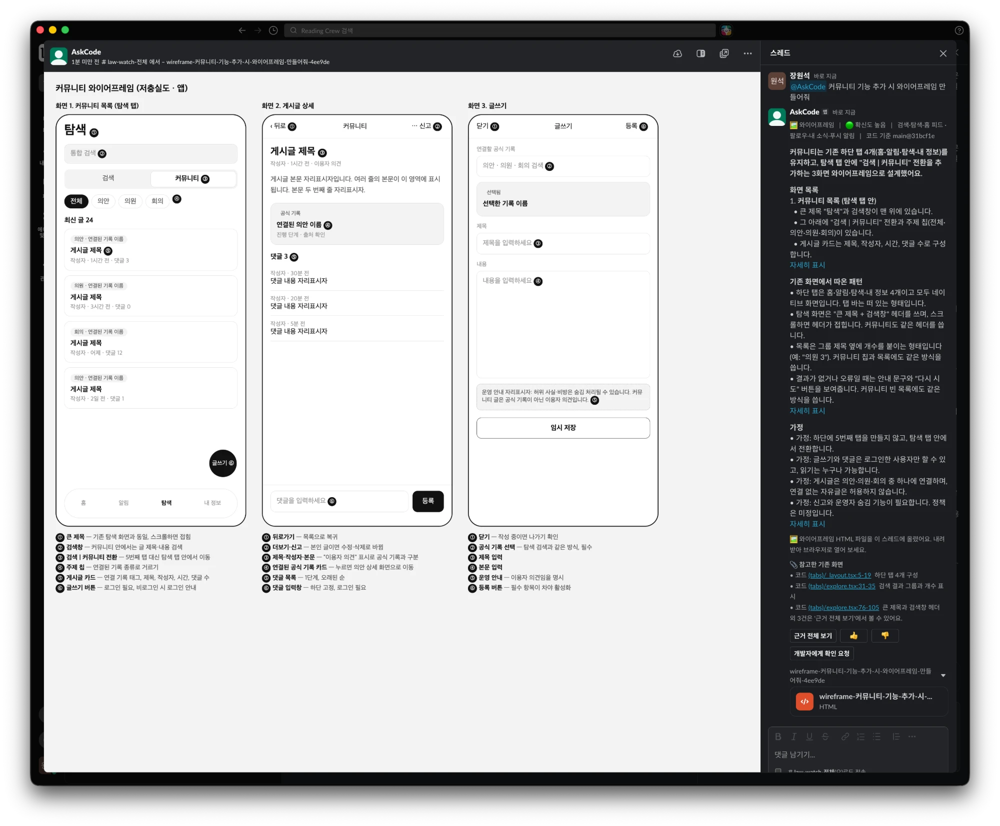

# 와이어프레임 생성

기획자가 슬랙에서 새 기능의 화면 초안을 요청하면, AskCode가 기존 화면의 구성 관례를 코드에서 읽고 **저충실도 HTML 와이어프레임**을 만들어 스레드에 파일로 올린다. 모델은 HTML을 직접 쓰지 않고 짧은 **화면 명세(JSON)**만 내며, 렌더러가 명세를 HTML로 그린다.



위 화면은 "커뮤니티 기능 추가 시 와이어프레임 만들어줘" 요청의 결과다(2026-10-15, `main@31bcf1e`, 모델이 HTML을 직접 쓰던 때).
- 오른쪽 스레드: 설명과 참고한 기존 화면, HTML 파일
- 왼쪽: 슬랙이 그 파일을 열어 보여 주는 미리보기. 앱 3화면(커뮤니티 목록 · 게시글 상세 · 글쓰기)에 번호 주석과 설명이 붙어 있다.

## 요청하는 법

슬랙에서 `@AskCode`를 멘션하거나 DM으로 보낸다.

| 예시 | 결과 |
| --- | --- |
| 커뮤니티 기능 추가 시 와이어프레임 만들어줘 | 앱 3화면 (목록 · 상세 · 글쓰기) |
| 의안 상세에 댓글 화면 추가하면 어떻게 생길지 화면 초안 그려줘 | 의안 도메인 화면을 참고한 초안 |
| 웹에서 의안 비교 화면 와이어프레임 만들어줘 | 1280px 웹 프레임 |

- "와이어프레임", "화면 초안", "목업"이 들어간 요청을 스코핑이 `wireframe`으로 분류한다.
- 화면 하나로 좁혀 요청할수록 빠르고 정확하다.
- 코드 수정·PR·배포처럼 AskCode가 하지 않는 작업은 `unsupported`로 분류해, "AskCode가 하지 않는 작업"이라고 안내한다. 개인정보 요청을 거절할 때 쓰는 문구와는 다르다.

## 결과물

| 위치 | 내용 |
| --- | --- |
| 스레드 답변 | 굵은 요약 한 줄, **따온 패턴** 2~3개, **가정**(정해지지 않은 기획 결정), 참고한 기존 화면 근거. 화면별 요소 설명은 파일의 번호 주석에만 둔다 |
| 스레드 파일 | `wireframe-<요청>-<id>.html`. 슬랙에서 바로 미리보기가 열리고, 내려받아 브라우저로 열 수도 있다 |
| CLI | `uv run askcode ask "…와이어프레임 만들어줘"` → `data/wireframes/`에 저장 |

HTML 형식은 다음과 같다. 렌더러가 그리므로 매번 같은 스타일이다.
- 회색조, 시스템 글꼴
- 앱이면 화면마다 390×844 프레임을 나란히 놓고, 웹이면 1280px 프레임 하나
- 각 프레임 위에 화면 이름, `note`를 단 요소에 번호(①②③), 프레임 아래에 번호별 설명
- 내용은 "게시글 제목", "작성자" 같은 자리표시자만 쓴다

## 동작 방식

```
질문 → 스코핑(haiku): kind=wireframe, 참고할 도메인
     → 와이어프레임 경로(sonnet, 최대 12턴, 읽기 전용 도구만)
         1. 비슷한 기존 화면 2~4곳을 find_screen·read_code로 확인 (하단 탭, 헤더, 목록 카드, 버튼 위치)
         2. 기존 관례를 따른 새 화면 설계, 정해지지 않은 것은 "가정"으로 표시
         3. 설명 + ```json 화면 명세 + 근거 출력
     → 명세 추출·검증 → 렌더러가 HTML 생성(텍스트 전부 이스케이프) + CSP 삽입
        (명세 대신 ```html이 오면 허용 목록 정제로 처리, 명세가 깨지면 "그리지 못했어요" 안내)
     → 근거 인용 검증 → 확신도
     → 슬랙: 답변 갱신 + files_upload_v2로 스레드에 파일 업로드
```

- 코드: `pipeline/wireframe.py`(명세 스키마·렌더러, 자유 HTML 정제), `pipeline/prompts.py`(`WIREFRAME_TEMPLATE`), `pipeline/answer.py`(경로), `slack/app.py`(`deliver`)
### 화면 명세

```json
{"title":"커뮤니티 (앱)","platform":"app","screens":[{"name":"1. 커뮤니티 목록","elements":[
{"type":"header","title":"커뮤니티","large":true},
{"type":"search","placeholder":"게시글 검색","note":"탐색 화면과 같은 검색창"},
{"type":"card_list","card":{"tag":"관련 의안명","title":"게시글 제목","meta":"작성자 · 1시간 전"},"count":4,"note":"게시글 카드, 탭하면 상세로"},
{"type":"fab","label":"글쓰기"},
{"type":"bottom_tabs","items":["홈","알림","탐색","커뮤니티","내 정보"],"active":3}]}]}
```

| 요소 | 필드 |
| --- | --- |
| `header` `search` `tabs` `chips` | 헤더(큰 제목/내비게이션 바), 검색창, 상단 탭, 필터 칩 |
| `card_list` `list` `section` `text` | 같은 모양 카드 반복(최대 6), 행 목록(들여쓰기로 답글), 구획 제목, 글 |
| `form_field` `button` `box` `notice` | 입력칸(여러 줄·선택형), 버튼, 이미지·차트 자리 박스, 안내 문구 |
| `table` `columns` | 웹: 표, 좌우 배치(한 단계) |
| `fab` `input_bar` `bottom_tabs` | 앱 하단 고정: 떠 있는 버튼, 입력창, 하단 탭 바 |

- 모든 요소에 `note`를 달 수 있고, 달면 번호 주석이 붙는다. 모르는 type·키는 무시한다.
- 화면 6개, 화면당 요소 40개, 문자열 200자에서 자른다. 그릴 요소가 하나도 없거나 JSON이 깨지면 실패로 본다.

- 에이전트의 도구는 질문 답변과 같은 읽기 전용 도구다. 봇이 쓰는 곳은 슬랙 스레드의 파일 하나뿐이다.

## 보안

모델 출력은 신뢰하지 않는다. 코드나 문서에 섞인 지시문이 출력에 들어올 수 있기 때문이다.

- 기본 경로(명세): 모델이 낸 값은 텍스트로만 쓰이고 모두 HTML 이스케이프된다. 태그·속성·CSS는 렌더러 코드에만 있으므로 스크립트나 외부 리소스가 들어갈 자리가 없다. 숫자 필드(높이·개수)는 범위를 잘라 쓴다. CSP도 그대로 넣는다.
- 예비 경로(자유 HTML): 모델이 명세 대신 HTML을 내면 아래 허용 목록 정제를 거친다.

| 막는 것 | 방법 |
| --- | --- |
| 스크립트 실행 | `<script>`·`<iframe>`·`<object>`·`<embed>`·`<svg>`를 내용째 제거, `on*` 이벤트 속성 제거 |
| 외부 접속(추적 픽셀, 데이터 유출) | `img src` 제거, `href`는 `#…`만 허용, CSS `@import`·`url()` 제거, `<link>`·`<meta http-equiv>` 제거 |
| 숨긴 지시문 | HTML 주석 제거 |
| 정제를 우회한 경우 | `Content-Security-Policy: default-src 'none'; style-src 'unsafe-inline'; img-src data:` 삽입 |
| 너무 큰 출력 | 200KB에서 자름 |

공격용 HTML 샘플로 위 항목이 모두 제거되는지, 명세의 모든 텍스트 필드에 넣은 스크립트·태그가 이스케이프되는지 `tests/test_wireframe.py`가 확인한다.

## 비용과 시간

같은 요청("커뮤니티 기능 추가 시 와이어프레임 만들어줘", CLI)으로 측정했다.

| | HTML 직접 작성 (이전) | | 화면 명세 + 렌더러 (현재) | |
| --- | --- | --- | --- | --- |
| | CLI | 슬랙 | 1건째 (캐시 없음) | 2건째 (캐시 있음) |
| 비용 | $0.105 | $0.093 | $0.068 | **$0.040** |
| 시간 | 37초 | 42초 | 17초 | **16초** |
| 모델 호출 | 8회 | 8회 | 7회 | 6회 |
| 출력 토큰 | 5,838 | 6,677 | 2,107 | 2,044 |
| 캐시 쓰기 토큰 | 15,470 | 6,758 | 15,378 | 5,149 |
| 모델 출력 크기 | HTML 10KB | | 명세 2.4KB | |

- 출력 토큰이 약 1/3로 줄어 출력 비용이 $0.06 → $0.02가 됐다. 시간도 절반 이하다.
- 남은 비용의 큰 몫은 **캐시 쓰기**다. 5분 안에 앞선 질문이 없으면 시스템 프롬프트(레포 개요 포함)를 새로 캐시에 써서 약 $0.025가 더 든다(1건째). 질문이 이어지는 동안은 2건째처럼 $0.04 안팎이다.
- 같은 요청에 대한 HTML 파일 크기는 비슷하다(약 9KB). CSS는 렌더러가 매번 같은 것을 넣는다.

## 설정

- 슬랙 앱 Bot Token Scopes에 `files:write`를 추가하고 **앱을 워크스페이스에 다시 설치**한다(README "슬랙 앱 설정").
- 권한이 없으면 답변은 그대로 나가고, "⚠️ 파일 업로드 권한(files:write)이 없어…" 안내가 붙는다.

## 한계

- 저충실도다. law-watch의 실제 디자인 시스템(색·컴포넌트)을 쓰지 않고, 화면 구성 관례만 따른다.
- 표현할 수 있는 요소는 명세 스키마에 있는 것뿐이다. 스키마에 없는 화면 요소는 `box`(자리 박스+라벨)로 대신한다.
- 같은 요청이라도 매번 화면 구성이 조금씩 다르다. 기획 회의의 출발점으로 쓰고, 확정안으로 쓰지 않는다.
- 골든 세트에는 와이어프레임 문항이 없다. 품질은 사람이 보고 판단한다.
